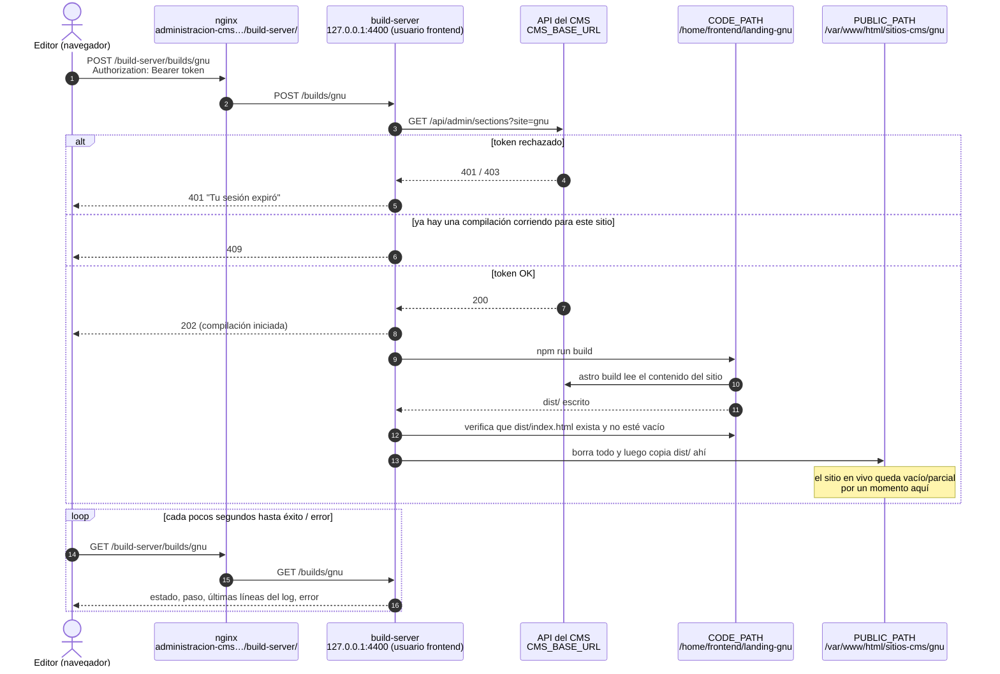

# build-server: instalación en el servidor de producción

## Valores reales en este servidor

| Qué | Valor | Notas |
|---|---|---|
| Carpeta del servicio | `/home/frontend/build-server` | Fuera de `/var/www/html`, así nginx nunca la sirve |
| Usuario del servicio | `frontend` | |
| URL del admin | `https://administracion-cms.165.227.59.215.sslip.io` | |
| Configuraciones de nginx | `/etc/nginx/conf.d/*.conf` | En este servidor **no** existe `sites-enabled/` |
| Código de gnu | `/home/frontend/landing-gnu` | `CODE_PATH`: aquí corre `npm run build` |
| Raíz web de gnu | `/var/www/html/sitios-cms/gnu` | `PUBLIC_PATH`: se vacía y se vuelve a llenar con `dist/` |

> [!IMPORTANT]
> **Regla de oro:** el servicio corre como `frontend`. Todo lo que hagas a mano en un `CODE_PATH`
> (`npm ci`, `git pull`, `npm run build`) también debe correr como `frontend`, **no como root**:
>
> ```bash
> sudo -u frontend -i
> ```
>
> Si root crea archivos ahí (`.astro/`, `node_modules/`, `dist/`), "Reconstruir sitio" falla con:
>
> ```
> EACCES: permission denied, open '/home/frontend/landing-gnu/.astro/content.d.ts'
> ```
>
> Arréglalo con los comandos `chown` del [paso 1](#1-copia-la-carpeta-y-configúrala).

---

## 1. Copia la carpeta y configúrala

Copia esta carpeta `build-server` (`server.mjs`, `.env.example`, …) a `/home/frontend/build-server`
(con `scp` o `rsync`) y luego, en el servidor:

```bash
chown -R frontend:frontend /home/frontend/build-server
sudo -u frontend -i
cd /home/frontend/build-server
cp .env.example .env
nano .env
```

En `.env` define:

```ini
ALLOWED_ORIGINS=https://administracion-cms.165.227.59.215.sslip.io
VITE_GNU_CODE_PATH=/home/frontend/landing-gnu
VITE_GNU_PUBLIC_PATH=/var/www/html/sitios-cms/gnu
```

- `ALLOWED_ORIGINS` debe ser la URL real del admin, no `localhost:5173`.
- Llena los pares de los otros sitios cuando existan. Si un par está vacío, la compilación de ese sitio falla de forma segura.

> [!CAUTION]
> **Nunca** apuntes un `PUBLIC_PATH` a una carpeta que contenga otras cosas (p. ej. la propia
> `/var/www/html/sitios-cms`). Todo su contenido se reemplaza después de cada compilación.

Todavía como `frontend`, verifica:

```bash
node -v                                      # 22.12 o más reciente. build-server en sí no necesita npm install.
which node                                   # anótalo, va en el archivo de la unidad (paso 2)
cd /home/frontend/landing-gnu && npm ci      # cada CODE_PATH necesita su node_modules
```

De vuelta como root (`exit`), dale a `frontend` la propiedad de cada `CODE_PATH` y `PUBLIC_PATH`:

```bash
chown -R frontend:frontend /home/frontend/landing-gnu
chown -R frontend:frontend /var/www/html/sitios-cms/gnu
```

Prueba una compilación a mano, como `frontend` (esto es exactamente lo que hace el botón):

```bash
sudo -u frontend -i bash -c 'cd /home/frontend/landing-gnu && npm run build'
```

Prueba el servicio a mano:

```bash
sudo -u frontend -i bash -c 'cd /home/frontend/build-server && npm start'
```

Deberías ver `build-server escuchando en http://localhost:4400` con las rutas de gnu listadas.
Detenlo con <kbd>Ctrl</kbd>+<kbd>C</kbd>.

---

## 2. Córrelo como servicio de systemd

```bash
nano /etc/systemd/system/build-server.service
```

Pega **una** de estas. Usa la ruta exacta que imprimió `which node` en el paso 1.

### a) `which node` imprimió `/usr/bin/node`

```ini
[Unit]
Description=CMS build-server (Astro site rebuilds)
After=network.target

[Service]
User=frontend
WorkingDirectory=/home/frontend/build-server
ExecStart=/usr/bin/node server.mjs
Restart=on-failure
Environment=NODE_ENV=production
Environment=ASTRO_TELEMETRY_DISABLED=1

[Install]
WantedBy=multi-user.target
```

### b) `which node` imprimió una ruta de nvm

Por ejemplo `/home/frontend/.nvm/versions/node/vXX.X.X/bin/node`. Reemplaza `v22.12.0` con tu
versión real en **ambas** líneas.

> [!WARNING]
> La línea `PATH` es obligatoria. systemd no lee `.bashrc`, así que sin ella la compilación falla
> con `npm: not found`.

```ini
[Unit]
Description=CMS build-server (Astro site rebuilds)
After=network.target

[Service]
User=frontend
WorkingDirectory=/home/frontend/build-server
ExecStart=/home/frontend/.nvm/versions/node/v22.12.0/bin/node server.mjs
Restart=on-failure
Environment=NODE_ENV=production
Environment=ASTRO_TELEMETRY_DISABLED=1
Environment=PATH=/home/frontend/.nvm/versions/node/v22.12.0/bin:/usr/bin:/bin

[Install]
WantedBy=multi-user.target
```

### Arráncalo

```bash
systemctl daemon-reload
systemctl enable --now build-server     # arranca ahora y en cada inicio
systemctl status build-server           # debe decir "active (running)"
journalctl -u build-server -f           # logs en vivo, incl. compilaciones fallidas
```

Si `status` dice `failed`, corre `journalctl -u build-server -n 50`. Normalmente es una ruta de `ExecStart`
equivocada o falta `/home/frontend/build-server/.env`.

Después de editar `.env` o el archivo de la unidad, o de copiar un `server.mjs` nuevo:

```bash
systemctl daemon-reload                 # solo hace falta si cambió el archivo de la unidad
systemctl restart build-server
```

---

## 3. Hazlo accesible desde el navegador (nginx)

El admin llama al build-server desde el navegador del editor, así que debe ser una URL HTTPS pública:

- `http://localhost:4400` apuntaría a la propia computadora del editor (`ERR_CONNECTION_REFUSED`).
- Un admin en HTTPS no puede llamar a `http://` plano (contenido mixto).

El archivo es `/etc/nginx/conf.d/administracion-cms.conf`. Ignora los archivos `*.bak-*` y `*.disabled`.

> [!WARNING]
> Respáldalo **fuera** de `conf.d`. nginx carga todos los `conf.d/*.conf`, así que un respaldo llamado
> `algo.conf` se cargaría como un sitio duplicado.

```bash
cp /etc/nginx/conf.d/administracion-cms.conf /root/administracion-cms.conf.bak-$(date +%Y%m%d-%H%M)
```

Encuentra el bloque server de HTTPS (el que tiene `listen 443 ssl`):

```bash
grep -n "listen\|server_name\|location" /etc/nginx/conf.d/administracion-cms.conf
```

En este servidor es el **primer** bloque (`server_name` en la línea 2, `listen 443` en la línea 11).
El segundo bloque (`listen 80`) es la redirección de Certbot. No lo toques.

```bash
nano +2 /etc/nginx/conf.d/administracion-cms.conf
```

Justo después de la línea `server_name`, al mismo nivel que `location / {` (no dentro de él), agrega:

```nginx
location /build-server/ {
    proxy_pass http://127.0.0.1:4400/;   # conserva AMBAS diagonales finales
    proxy_read_timeout 60s;
}
```

Luego:

```bash
nginx -t && systemctl reload nginx
```

En `gnu-cms-admin/.env` (sin diagonal final):

```ini
VITE_BUILD_SERVER_URL=https://administracion-cms.165.227.59.215.sslip.io/build-server
```

Se lee en tiempo de compilación, así que después vuelve a compilar y desplegar el admin.

Mantén el puerto `4400` cerrado en el firewall. Solo debe ser accesible a través de nginx.

---

## 4. Verifícalo

```bash
curl -i http://127.0.0.1:4400/builds/gnu
curl -i https://administracion-cms.165.227.59.215.sslip.io/build-server/builds/gnu
```

Ambos deben regresar **401** (sin token). Eso significa que el servicio está corriendo y es accesible. El
botón del admin manda el token real.

| Resultado | Significado |
|---|---|
| `401` | Funciona |
| `404` | El bloque `location` está en el bloque server equivocado (puerto 80 u otro dominio) |
| `502` | El servicio no está corriendo: `systemctl status build-server` |
| `EACCES` en el error del botón | Archivos propiedad de root: repite el `chown` del paso 1 |

---

## 5. Después de cambiar `/home/frontend/build-server/.env`

`.env` se lee una sola vez, cuando arranca el servicio. Guardar el archivo no cambia nada hasta que reinicies.

Edítalo como `frontend`, para que el archivo siga siendo propiedad de `frontend`:

```bash
sudo -u frontend -i
nano /home/frontend/build-server/.env
exit
```

> [!CAUTION]
> Antes de reiniciar, asegúrate de que no haya ninguna compilación corriendo. Reiniciar mata una compilación en curso, y la
> raíz web de ese sitio puede quedar publicada a medias. Esto no debe imprimir nada:
>
> ```bash
> pgrep -u frontend -af "astro build"
> ```

Reinicia y confirma:

```bash
systemctl restart build-server
systemctl status build-server              # debe decir "active (running)"
journalctl -u build-server -n 20           # las líneas de arranque listan las rutas que cargó
curl -i http://127.0.0.1:4400/builds/gnu   # se espera 401
```

### Pasos extra, según lo que hayas cambiado

**Agregaste o cambiaste el `CODE_PATH` / `PUBLIC_PATH` de un sitio**

- Las carpetas ya deben existir, y la carpeta del código necesita `node_modules`:
  ```bash
  sudo -u frontend -i bash -c 'cd <CODE_PATH> && npm ci'
  ```
- Dale a `frontend` la propiedad de ambas (como root):
  ```bash
  chown -R frontend:frontend <CODE_PATH> <PUBLIC_PATH>
  ```
- `PUBLIC_PATH` debe ser la carpeta propia de ese sitio (p. ej. `/var/www/html/sitios-cms/gnu`), nunca una
  carpeta padre como `/var/www/html/sitios-cms`. Su contenido se reemplaza en cada compilación.
- Prueba la compilación a mano como `frontend` antes de usar el botón (ver paso 1).

**Cambiaste `PORT`**

- Actualiza el puerto de `proxy_pass` en `/etc/nginx/conf.d/administracion-cms.conf` (paso 3) y luego:
  ```bash
  nginx -t && systemctl reload nginx
  ```

**Cambiaste `ALLOWED_ORIGINS` o `CMS_BASE_URL`**

- Nada más: basta con reiniciar. El admin no necesita volver a compilarse.

> [!NOTE]
> El `VITE_BUILD_SERVER_URL` del admin **no** está en este archivo. Vive en `gnu-cms-admin/.env` y
> requiere volver a compilar y desplegar el admin (paso 3), no reiniciar el build-server.

---

## 6. Lo que DevOps / el webmaster debe saber

### Cómo funciona una reconstrucción

Cuando un editor hace clic en "Reconstruir sitio", el servicio:

1. Valida el token del editor llamando al CMS (`CMS_BASE_URL/api/admin/sections`).
2. Corre `npm run build` en el `CODE_PATH` del sitio.
3. Verifica que `dist/index.html` exista y no esté vacío.
4. **Borra todo** en `PUBLIC_PATH` y copia `dist/` ahí.



> [!NOTE]
> El diagrama es Mermaid. GitHub y GitLab lo dibujan automáticamente; en VS Code, instala la
> extensión "Markdown Preview Mermaid Support" para verlo en la vista previa.

Lo que se desprende de eso:

- **El sitio en vivo es el código que esté en `CODE_PATH`.** Para desplegar un cambio de código, actualiza `CODE_PATH`
  (`git pull` como `frontend`) y luego reconstruye con el botón o a mano. Cualquier cosa sin commit o
  a medio pull ahí sale en vivo con el siguiente clic.
- **Nunca edites archivos directamente en `PUBLIC_PATH`.** Se borran en la siguiente reconstrucción. Todo lo que
  deba sobrevivir (p. ej. `robots.txt`, archivos de verificación, `.well-known/`) va en la carpeta `public/` del sitio.
- **La publicación no es atómica.** Por un momento durante el paso 4 la carpeta está vacía o parcial, así que los visitantes pueden
  recibir un 404 por un segundo. Si el proceso muere a mitad de la copia, el sitio queda publicado a medias hasta la siguiente
  reconstrucción exitosa.
- **No hay rollback automático.** La versión anterior no se guarda. Para regresar, haz checkout del commit anterior
  en `CODE_PATH` y reconstruye, o guarda tu propio respaldo de `PUBLIC_PATH`.
- **Una compilación "exitosa" no siempre es correcta.** Si el CMS está caído durante la compilación, el sitio aún puede
  producir un `index.html` con contenido faltante, y se publica. Revisa el sitio después de una reconstrucción
  que haya ocurrido durante una caída del CMS.
- **El estado de la compilación vive en memoria.** Un reinicio borra el progreso/último error que muestra el admin. Los logs reales
  están en `journalctl -u build-server`.
- **Una compilación por sitio a la vez** (un segundo clic recibe un 409), pero **sitios distintos pueden compilar al
  mismo tiempo.** Cada compilación de Astro puede usar 1 GB+ de RAM. En un servidor pequeño, agrega swap o pide a los editores que no
  reconstruyan varios sitios a la vez. Un kill por falta de memoria aparece como `terminó con código 137` o `señal SIGKILL`;
  confírmalo con `dmesg | grep -i oom`.

### Seguridad

- **El servicio escucha en todas las interfaces**, no solo en `127.0.0.1`. El firewall es lo que mantiene privado el puerto `4400`.
  Verifica que esté cerrado desde fuera: `curl -m 5 http://<server-ip>:4400/builds/gnu` desde tu propia
  computadora debe agotar el tiempo de espera.
- **Cualquiera que pueda iniciar sesión en el admin puede disparar reconstrucciones.** No hay límite de frecuencia. Está bien para un
  puñado de editores. Si se vuelve un problema, agrega `limit_req` de nginx a la location `/build-server/`.
- **Lo que está en el archivo de la unidad gana sobre `.env`.** Si una variable se define con `Environment=` en el archivo de la unidad,
  el valor de `.env` para ella se ignora. Mantén la configuración de los sitios solo en `.env`.
- **Los mensajes de error en el admin incluyen rutas del servidor y salida de la compilación.** Está bien para editores de confianza; tenlo
  en cuenta antes de darle acceso al admin a gente de fuera.

### Este servidor (Linux de la familia RHEL con SELinux)

El servidor usa `/etc/nginx/conf.d/`, lo que indica un sistema RHEL/CentOS/Rocky/Alma. Verifícalo con
`cat /etc/os-release` y `getenforce`. Si `getenforce` imprime `Enforcing`:

- **Puede que nginx no tenga permiso de hacer proxy al puerto 4400.** Síntoma: 502, y `/var/log/nginx/error.log` muestra
  `connect() to 127.0.0.1:4400 failed (13: Permission denied)`. Solución:
  ```bash
  setsebool -P httpd_can_network_connect 1
  ```
- **Puede que nginx no tenga permiso de leer los archivos publicados.** Síntoma: 403 en el sitio público después de una reconstrucción.
  Arregla las etiquetas:
  ```bash
  restorecon -Rv /var/www/html/sitios-cms
  ```
- El firewall es `firewalld`. Lista lo que está abierto con `firewall-cmd --list-all`. `4400` no debe aparecer.

### Mantenimiento

- **Actualizar Node con nvm cambia su ruta.** Actualiza `ExecStart` y `PATH` en el archivo de la unidad y luego
  `systemctl daemon-reload && systemctl restart build-server`. Si no, el servicio se queda con el Node anterior, o
  falla si la versión anterior se eliminó. También vuelve a correr `npm ci` en cada `CODE_PATH`.
- **Las renovaciones de Certbot no quitan el bloque `location /build-server/`**, pero revísalo de nuevo después de correr
  `certbot --nginx` otra vez para ese dominio.
- **Espacio en disco:** cada `CODE_PATH` contiene `node_modules/` y `dist/`. Revísalo con `df -h` y
  `du -sh /home/frontend/*`.
- **Los logs** van a journald, que los rota por su cuenta. Tamaño: `journalctl --disk-usage`.
- **Agregar un sitio nuevo** no es solo `.env`: la lista de sitios (`gnu`, `gas-natural`, `trainin`, `tectuus`) está
  fija en `server.mjs` (`SITES`). Ojo: la variable de trainin se escribe `VITE_TRANINN_*`.

---

## 7. Despliegue en Azure

El build-server necesita tres cosas en **la misma máquina**: el código fuente del sitio con `node_modules`
(`CODE_PATH`), una carpeta que sirva el servidor web (`PUBLIC_PATH`) y un proceso de Node de larga duración que pueda correr
`npm run build`. Eso descarta la mayoría de las opciones "serverless", así que aquí van las alternativas, de la más simple a la más
compleja.

### Opción A: VM Linux en Azure (recomendada)

La misma configuración de este README, en una VM:

1. **Crea la VM.** Ubuntu 24.04 LTS, al menos 2 vCPU / 4 GB de RAM (p. ej. `Standard_B2s`) por las
   compilaciones de Astro. Dale una IP pública estática y un nombre DNS.
2. **Network Security Group:** permite entrada en `22` (SSH, idealmente solo desde la IP de tu oficina), `80` y `443`.
   **No abras `4400`.** Dentro de la VM, habilita también `ufw`:
   ```bash
   ufw allow OpenSSH && ufw allow 'Nginx Full' && ufw enable
   ```
3. **Instala el software:**
   ```bash
   apt update && apt install -y nginx git certbot python3-certbot-nginx
   adduser frontend
   sudo -u frontend -i   # luego instala nvm y Node 22 para este usuario
   ```
4. **Sigue los pasos 1–5 de este README**, con estas diferencias de Ubuntu:

   | Este servidor (RHEL) | Ubuntu en Azure |
   |---|---|
   | `/etc/nginx/conf.d/<site>.conf` | `/etc/nginx/sites-available/<site>`, habilitado con `ln -s` hacia `sites-enabled/` |
   | Respaldar fuera de `conf.d` | Respaldar fuera de `sites-enabled/` (misma razón) |
   | nginx corre como `nginx` | nginx corre como `www-data` |
   | SELinux (`setsebool`, `restorecon`) | AppArmor, no hay nada que hacer |
   | `firewalld` | `ufw` + el NSG de Azure |

5. **HTTPS:** `certbot --nginx -d admin.yourdomain.com -d gnu.yourdomain.com`. Antes, apunta los registros DNS a la
   IP pública de la VM.
6. **Respaldos:** habilita Azure Backup para la VM, o al menos toma un snapshot del disco del sistema operativo antes de cambios grandes.

### Opción B: VM para compilaciones + sitio web estático de Azure Storage para los sitios públicos

Usa esta si quieres los sitios públicos en Azure Storage (contenedor `$web`), opcionalmente detrás de Azure Front
Door, en lugar de nginx. El build-server sigue corriendo en una VM (Opción A). Solo cambia `PUBLIC_PATH`: monta
el contenedor `$web` en la VM con **BlobFuse2** y apunta `PUBLIC_PATH` al punto de montaje.

1. Crea una cuenta de Storage (StorageV2), habilita **Static website** y anota su contenedor `$web`.
2. En la VM, instala BlobFuse2 y monta el contenedor, p. ej. en `/mnt/gnu-web`
   (ver la guía de Microsoft "Mount an Azure Blob Storage container on Linux with BlobFuse2"). Haz que el montaje sea
   permanente (systemd o `/etc/fstab`) y que `frontend` pueda leerlo y escribirlo.
3. En `.env`: `VITE_GNU_PUBLIC_PATH=/mnt/gnu-web` y luego `systemctl restart build-server`.
4. Una cuenta de Storage por sitio: `PUBLIC_PATH` se borra por completo, así que solo debe contener ese sitio.

> [!WARNING]
> - Publicar sobre BlobFuse2 es más lento que a un disco local, y la ventana de "vacío por un momento" es más larga.
> - Si Azure Front Door cachea el sitio, el contenido nuevo no se verá hasta que expire la caché o la purgues:
>   ```bash
>   az afd endpoint purge --resource-group <rg> --profile-name <profile> --endpoint-name <endpoint> --content-paths '/*'
>   ```
>   El build-server no hace esto por ti. Usa tiempos de caché cortos para el HTML, o purga a mano después de una reconstrucción.

### Opción C: Azure App Service / Container Apps (no recomendada)

Es posible, pero va en contra de cómo funciona el servicio:

- El estado de la compilación se guarda en memoria, así que necesita **exactamente una instancia** (sin scale-out).
- `CODE_PATH`, `PUBLIC_PATH` y `node_modules` deben estar en almacenamiento persistente (`/home` en App Service), y
  algo tiene que servir `PUBLIC_PATH` como sitio web.
- Los reinicios y las actualizaciones de la plataforma matan cualquier compilación en curso.

Considérala solo si no se permite una VM.

### Admin y CORS en Azure

- Si el admin está alojado en un **dominio distinto** al del proxy `/build-server/` (p. ej. el admin en Azure
  Static Web Apps y el build-server en una VM), pon el origen exacto del admin en `ALLOWED_ORIGINS`
  (`https://<name>.azurestaticapps.net` y/o su dominio propio, separados por comas).
- `VITE_BUILD_SERVER_URL` siempre debe ser la URL HTTPS pública del proxy, nunca `localhost` ni la
  IP privada de la VM.
- La VM debe poder llegar a `CMS_BASE_URL` por HTTPS (la salida está abierta por defecto en Azure; revísalo si
  tu NSG restringe el tráfico de salida). Cada reconstrucción y cada validación de token dependen de ello.
